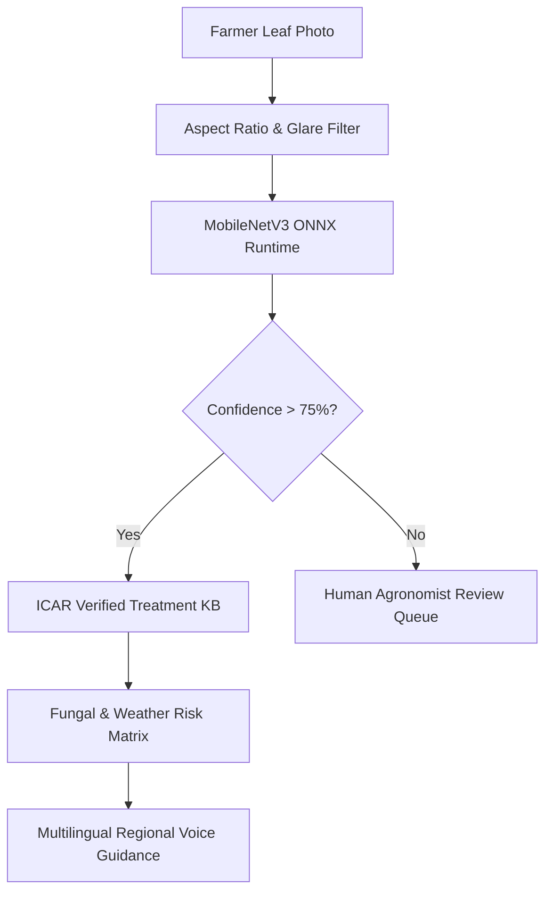

# KrishiScan AI Crop Disease Diagnosis Pipeline

## Architecture Overview
The diagnosis pipeline processes photographs of affected crop leaves through an on-device ONNX runtime neural classifier, cross-referencing meteorological signals and verified agricultural remedies.

